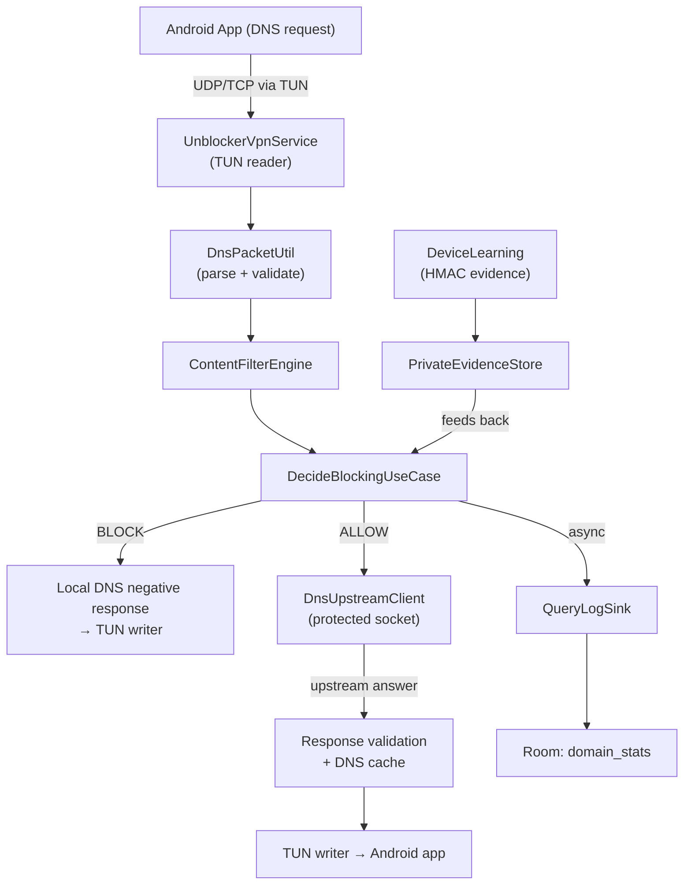

# Architecture — runtime and Gradle modules

## Tech Stack

| Component | Library / Version | Notes |
|---|---|---|
| Language | Kotlin 2.0.21 | |
| Build toolchain | AGP 8.10.1, JDK 17 | |
| UI toolkit | Jetpack Compose BOM 2024.10.00 | |
| Navigation | Jetpack Navigation Compose 2.8.3 | |
| DI | Hilt 2.51.1 | hilt-navigation-compose 1.2.0, hilt-work 1.2.0 |
| Database | Room 2.6.1 (schema v2) | |
| Async | Kotlin Coroutines 1.8.1 | |
| Background work | WorkManager 2.9.1 | |
| ML (declared) | TFLite 2.16.1 | Dependency present; **not actively used** — see note below |
| Utilities | Guava 33.2.1-android | |
| Min / Target SDK | 26 / 35 | Android 8.0+ |

> [!NOTE]
> TFLite is a declared Gradle dependency in `:ml-engine` but the runtime path uses
> `HeuristicDomainClassifier`, not a TFLite model. Do not assume ML inference is active
> without tracing call sites and Hilt bindings first.

---

## Real runtime entrypoint

```text
Android → UnblockerApplication; MainActivity → MainScreen (Compose)
                          |                   |→ Protection screen / Settings
                          |                   |→ Logs / Extensions / Learn App
                          |                   |→ QuickStartManager (VPN consent/lifecycle)
                          +→ Hilt, WorkManager, preferences, QueryLogSink

Android VpnService permission → app/src/main/java/com/unblocker/app/services/UnblockerVpnService.kt
   |  TUN packet reader (IPv4/IPv6 + DNS UDP/TCP)
   v
 app/src/main/java/com/unblocker/app/logic/dns/DnsPacketUtil + validation
   v
 app/src/main/java/com/unblocker/app/logic/ContentFilterEngine.kt
   v
 app/src/main/java/com/unblocker/app/domain/usecase/DecideBlockingUseCase.kt
   |---- normalize / pause / user overrides
   |---- mode / infrastructure safety / mobile-compatibility
   |---- static + extension rules / local evidence / adult rules
   |---- BLOCK → local DNS negative answer → TUN writer
   `---- ALLOW → DNS cache / protected socket → Android-network resolver
                 → validate matching upstream answer → cache → TUN writer
                          |
                          `→ QueryLogSink (bounded async) → Room domain_stats
```

This is **logical**, not a timing diagram. Concrete call ordering is specified by `UnblockerVpnService.kt`, `DnsUpstreamClient.kt` and `DecideBlockingUseCase.kt`.

---

## Data Flow

The end-to-end data flow from a DNS query to a logged decision:



> [!IMPORTANT]
> `QueryLogSink` receives decisions **asynchronously** to avoid blocking the DNS
> forwarding path. Local query-log aggregates stored in Room may contain readable
> (plaintext) domain strings — see [PRIVACY_DATA_FLOW.md](PRIVACY_DATA_FLOW.md).

### Learning feedback loop

`DeviceLearning` accumulates HMAC-keyed evidence about per-app DNS patterns and stores it in `PrivateEvidenceStore`. This evidence feeds back into `DecideBlockingUseCase` to influence future allow/block decisions. HMAC identifiers protect raw domain strings at rest; however log aggregates in Room may store readable domains.

---

## Gradle dependency graph (observed)

```text
                       :app
                   /    |    \
            :vpn-engine :ml-engine :data-store
                   \    |        /
                      :common
```

Actual declared edges: `:app → :common, :vpn-engine, :data-store, :ml-engine`; `:vpn-engine → :common, :data-store`; `:ml-engine → :common, :data-store`; `:data-store → :common`. `:common` has no internal project dependency. See `settings.gradle.kts` and `*/build.gradle.kts`.

---

## Critical distinction: physically present versus runtime active

> [!WARNING]
> There are **two sets of DNS/VPN/learning-related facilities**. The manifest-declared service is `app/src/main/java/com/unblocker/app/services/UnblockerVpnService.kt`, with `app/src/main/java/com/unblocker/app/logic/dns/*` parsing and `app/src/main/java/com/unblocker/app/services/DnsUpstreamClient.kt` forwarding. `vpn-engine/` also has `VpnConfiguration`, `DnsPacketParser`, and `DnsForwarder`, but its existence does not prove the manifest service delegates to it. Likewise `:ml-engine` contains a batch worker and a heuristic classifier; inspect schedule/call sites before claiming the worker learns in production. **Trace callers and Hilt bindings and provide proof before consolidating.**

---

## Dependency Injection

Hilt 2.51.1 is the DI framework. Key bindings:

| Module | Binding |
|---|---|
| `MlEngineModule` | Binds `HeuristicDomainClassifier` → `DomainClassifier` interface |
| App module | Wires `QueryLogSink`, `FilteringPreferences`, `ExtensionRepository`, `ResolverRegistry` |

Additional Hilt integrations:
- **`hilt-navigation-compose` (1.2.0):** Provides `hiltViewModel()` for Compose screens; ViewModels are scoped to nav back-stack entries.
- **`hilt-work` (1.2.0):** Enables `@HiltWorker` for WorkManager workers that need injected dependencies (extension updater, health checks).

WorkManager is used for **bounded background actions** only (extension list updates, health checks). Never assume a worker will run at a specific time; Android may defer or drop it.

---

## Navigation

Navigation is implemented with **Jetpack Navigation Compose 2.10.2** (`NavHost` + `UnblockerNavigation.kt` routes) and **`DeepLinkParser`** (`unblocker://home`, `://logs?domain=<d>`, `://learn`, `://settings/<section>`, `://exceptions`, `://stats`, `://extensions`, `://onboarding`, `://about`, `://start` which opens the app without silently starting the VPN).

`MainScreen.kt` owns:
- `NavHost` destination graph with per-tab state preservation across top-level tabs
- `DeepLinkParser` dispatch from `MainActivity`
- The VPN consent launcher (`ActivityResultLauncher` for `VpnService.prepare()`)

### Screens

| Route | Composable | Purpose |
|---|---|---|
| `home` | `UnblockerScreen` | VPN toggle, quick-start, status |
| `learn` | `LearnAppScreen` | Isolated per-app learning controls |
| `logs?domain={domain}` | `LogViewerScreen` | Filtered DNS event log |
| `settings?section={section}` | `SettingsScreen` | Filtering mode, preferences |
| `extensions` | `ExtensionsScreen` | Extension list management |
| `exceptions` | `ExceptionsScreen` | User exceptions & rule tester destination |
| `stats` | `StatisticsScreen` | On-device statistics destination |
| `onboarding` | `OnboardingScreen` | Guided setup destination |
| `about` | `AboutScreen` | App metadata, privacy contract, source links |

Navigation UI uses a **`FloatingPillNavBar`** component (custom bottom tab bar with pill indicator).

---

## State Management

| Layer | Mechanism | Notes |
|---|---|---|
| Filtering preferences | `FilteringPreferences` via `StateFlow` + `SharedPreferences` | Reactive; survives process death |
| UI state | `StateFlow` in ViewModels | Collected as `State<T>` in Compose via `collectAsStateWithLifecycle` |
| VPN session state | Owned by `UnblockerVpnService` | Not in ViewModel; observed via binder or broadcast |
| Compose UI | Hoisted state pattern | State lives in ViewModel or top-level composable, passed down |

> [!NOTE]
> VPN session state is **separately owned by the service**, not by any ViewModel. UI
> that needs to reflect VPN status must observe it through the service binder or an
> appropriate IPC mechanism, not from a ViewModel field directly.

---

## Lifecycle and state

- Startup initializes Keystore-related safety policies, query log sink, preferences, and `QuickStartManager` (`UnblockerApplication.kt`).
- Android must grant VPN consent; the service is foreground and not externally exported; notification and boot behavior depend on Android versions/OEM policy.
- `FilteringPreferences` uses reactive `StateFlow` and shared preferences; tunnel/session status is separately owned by service state.
- Network changes refresh **Android-configured, usable non-VPN** resolvers through `ResolverRegistry`. Guard against resolvers changing mid-forward; block loopback/private-network misuse.
- WorkManager schedules bounded extension/health-related background actions where configured; never invent guaranteed run times.

---

## Persistence

- `data-store` Room schema (v2) has domain stats/events, DNS logs, block and whitelist entities, DAOs and explicit `UnblockerMigrations.MIGRATION_1_2`.
- App private `DeviceLearning` stores HMAC identifiers; preferences persist filtering settings; log aggregates in Room may store readable domains (see [privacy](PRIVACY_DATA_FLOW.md)).
- Build-time rule compiler packages deterministic DNS rule assets; runtime extension lists are a separate bounded network/update path.

---

## Navigation (links)

[Detailed modules](PROJECT_MODULES.md) | [DNS pipeline](DNS_PIPELINE.md) | [Exact decisions](BEHAVIOR_CONTRACTS.md) | [Test strategy](TESTING_STRATEGY.md) | [Architecture review questions](REPO_RECONCILIATION.md)
