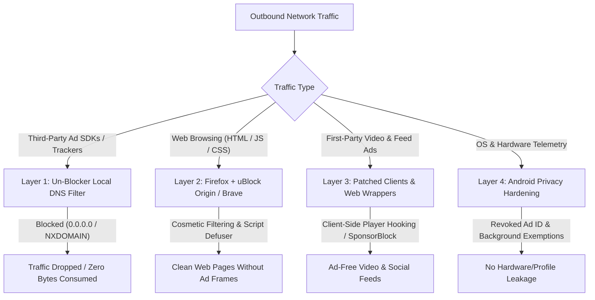

# Comprehensive Device-Wide Ad & Tracking Elimination Guide

## 1. Executive Summary & Defense-in-Depth Architecture

Modern advertising and behavioral tracking operates across multiple network layers, application boundaries, and operating system services. No single tool or layer can eliminate 100% of advertisements alone:

* **DNS Filtering (Un-Blocker)**: Intercepts network queries on port 53 and blocks 80–90% of all ad server, telemetry, and tracking connections before a single byte of media is downloaded. However, DNS cannot see inside encrypted HTTPS payloads or inspect in-page HTML Document Object Model (DOM) elements.
* **Cosmetic & Content Filtering (Browsers)**: Collapses empty visual frames, defuses anti-adblock scripts, and removes cookie consent popups inside web pages.
* **Stream & In-Feed Player Hooking**: Neutralizes video pre-rolls and in-stream ads (such as YouTube and Twitch) where ads and video content share identical delivery CDN domains (`*.googlevideo.com`).
* **OS-Level Hardening**: Closes background leakage channels, revokes Advertising IDs, and prevents OEM background killers from stopping protection services.

---

## 2. Layer 1: Un-Blocker Curated Defense Presets

Un-Blocker packages curated, non-overlapping filter presets to maximize blocking coverage while preserving device RAM, CPU cycles, and battery life.

### Available Presets in Un-Blocker

| Preset | Target Scope | Included Filter Lists | Ideal For |
|---|---|---|---|
| **Essential (Zero Breakage)** | Baseline ad & malware suppression | OISD Small, uBlock Unbreak, AdGuard DNS Filter, ThreatFox / URLhaus C2 | Banking, government, shopping, and work apps where false positives cannot be tolerated |
| **Recommended (Balanced)** | Comprehensive mobile blocking + OEM & DoH protection | HaGeZi Multi PRO, AdGuard DNS, AdAway Mobile, EasyPrivacy, uBlock Unbreak, HaGeZi DoH Bypass, Malware C2, OEM Telemetry | Everyday primary phone setup. Blocks mobile SDKs (Unity, AppLovin, AdMob) and OEM telemetry |
| **Aggressive (Maximum Shield)** | Full-device hardening against all tracking and annoyances | All Recommended lists + Mobile App Ads, Fanboy Social, uBlock Annoyances, Phishing Army, Microsoft Telemetry | Users demanding absolute privacy; occasional manual whitelisting may be needed |

### Dynamic OEM Telemetry Auto-Detection
When activating the **Recommended** or **Aggressive** preset, Un-Blocker inspects the device manufacturer and automatically attaches manufacturer-specific blocklists:
* **Samsung**: Enables `hagezi_native_samsung` to block Samsung Push Service, Knox telemetry, and analytics.
* **Xiaomi / Redmi / POCO**: Enables `hagezi_native_xiaomi` to block MIUI/HyperOS analytics and MSA daemon tracking.
* **Apple (paired sync)**: Enables `hagezi_native_apple` metrics blocking.

### Hardened DoH Bypass Blocker
Rogue mobile apps often bundle encrypted DNS-over-HTTPS (DoH) bootstrap resolvers (like Cloudflare or Google DoH) to bypass local port-53 VPN interception. The **Recommended** and **Aggressive** presets automatically enable `hagezi_doh_bypass` to prevent resolution of public encrypted DNS endpoints.

---

## 3. Layer 2: Android System Hardening Checklist

Android battery management and system DNS settings can silently degrade or bypass VPN protection if not properly configured.

### 1. Battery Optimization Exemption
* **The Problem**: Aggressive OEM task killers (OneUI, HyperOS, ColorOS) silently terminate background VPN services during screen-off sleep.
* **The Fix**: Open **Un-Blocker → Settings → System Hardening Checklist** and tap **Exempt**, or navigate to:
  `Settings` → `Apps` → `Un-Blocker` → `Battery` → Select **Unrestricted**.
* On Xiaomi/HyperOS: Enable **Autostart** under app permissions.

### 2. Disable System "Private DNS"
* **The Problem**: Android 9+ includes a system "Private DNS" feature (DNS-over-TLS). When active, Android routes DNS queries directly to external DoT servers outside the local VPN loopback, causing ads to reappear.
* **The Fix**: Open **Un-Blocker → Settings → System Hardening Checklist** and tap **Turn Off**, or navigate to:
  `Settings` → `Network & internet` → `Private DNS` → Select **Off**.

### 3. Enforce Always-On VPN and Lockdown
* **The Problem**: During network switches (e.g., Wi-Fi to LTE) or service restarts, unencrypted DNS queries can momentarily leak to mobile carrier resolvers.
* **The Fix**: Navigate to `Settings` → `Network & internet` → `VPN` → Tap the gear icon next to **Un-Blocker** → Enable **Always-on VPN** and toggle on **Block connections without VPN**.

### 4. Delete Android Advertising ID
* **The Problem**: Google Play Services assigns every device a unique Advertising ID used by ad networks for behavioral cross-app profiling.
* **The Fix**: Navigate to `Settings` → `Security & Privacy` → `Privacy` → `Ads` (or `Google` → `Ad privacy`) → Tap **Delete advertising ID**. Once deleted, all apps receive a null identifier (`00000000-0000-0000-0000-000000000000`).

---

## 4. Layer 3: Content & Cosmetic In-Page Filtering (Browsers)

DNS filtering prevents connections to ad networks, but web browsers will render empty blank rectangles or "failed to load" frames where banner ads used to sit. Browser-level content blockers solve this through **cosmetic filtering** (CSS rule injection) and script defusing.

### Recommended Browser Solutions

1. **Firefox for Android + uBlock Origin (Maximum Protection)**:
   * Install **Firefox for Android** from Google Play or F-Droid.
   * Open Firefox Settings → **Add-ons** → Install **uBlock Origin**.
   * In uBlock Origin settings, enable:
     * `uBlock filters – Annoyances`
     * `EasyList Cookie List` (removes GDPR cookie popups)
     * `Fanboy’s Annoyance List`
   * Enable background audio playback in Firefox settings to allow ad-free background web streaming.

2. **Brave Browser (Zero-Configuration Alternative)**:
   * Install **Brave Browser** from Google Play.
   * Set **Brave Shields** to **Aggressive (Block trackers & ads)**.
   * Under Shields settings, toggle on **Block cookie consent notices**.

---

## 5. Layer 4: First-Party Stream & In-Feed Ad Neutralization

First-party ads share the same domain and TLS connection as actual content. Blocking the domain at the DNS level breaks media playback entirely.

### Strategy Matrix

| Service | Mechanism | Solution | Risk / Tradeoff |
|---|---|---|---|
| **YouTube (App)** | Stream stitched from `googlevideo.com` | **YouTube ReVanced** or **NewPipe / Tubular** | Requires manual APK installation. Delivers ad-free video, background playback, and SponsorBlock. |
| **YouTube (Web)** | HTML5 player | **Firefox + uBlock Origin** (`m.youtube.com`) | 100% ad-free, zero account ban risk, supports background play. |
| **Instagram / Facebook** | In-feed native GraphQL objects | **PWA via Brave or Firefox** | Web Progressive Web Apps (PWAs) bypass in-feed sponsor tracking without modded APK ban risks. |
| **Reddit** | Promoted posts in feed | **RedReader** (official API exception) or **Firefox Web PWA** | Clean feed without sponsored ads or promotional carousels. |
| **Twitch** | Server-side ad insertion (SSAI) | **PurpleTV** or **Firefox + TTV LOL extension** | Bypasses mid-stream video insertions. |

---

## 6. Layer 5: Router & Perimeter Fallback

For home Wi-Fi networks where devices may temporarily pause local VPN protection:
* **Upstream Router Resolver**: Configure router DHCP to distribute privacy-preserving DNS endpoints (such as AdGuard DNS, NextDNS, or a local Pi-hole / AdGuard Home server).
* **Dual-Layer Benefit**: When Un-Blocker is running on the device, local VPN rules filter queries on-device. When away from the VPN, the router maintains perimeter defense.

---

## 7. Verification & Benchmarking Checklist

Verify full defense-in-depth posture using these automated and manual benchmarks:

1. **Ad-Block Benchmark**:
   * Open browser and navigate to [d3ward Ad Block Test](https://d3ward.github.io/toolz/adblock.html).
   * Target score with Un-Blocker + Firefox/uBlock: **95% to 100%**.
2. **DNS Leak Test**:
   * Visit [dnsleaktest.com](https://www.dnsleaktest.com) and perform an **Extended Test**.
   * Confirm that only Un-Blocker's upstream resolver appears and no ISP or DoT leaks exist.
3. **In-App Query Log**:
   * Open ad-supported apps (e.g., Speedtest, casual games).
   * Open **Un-Blocker → Logs** tab to confirm that requests to `googleads.g.doubleclick.net`, `unity3d.com`, and `applovin.com` are marked **BLOCKED**.
