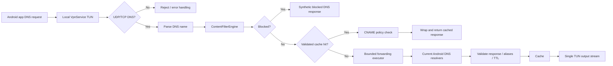
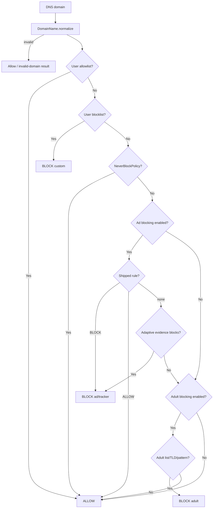
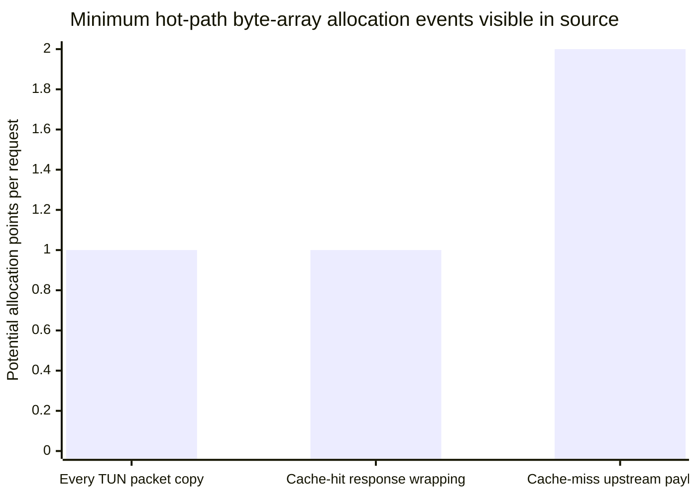
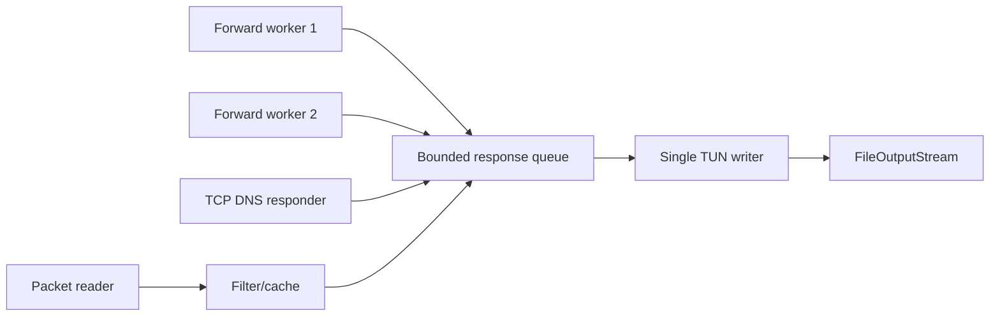

# Deep Technical Audit and Improvement Plan for `pkgtm2419/un-blocker`

## Executive summary

`un-blocker` is currently an **Android-only DNS-filtering application**, not a cross-platform VPN. The Gradle project contains `app`, `common`, `vpn-engine`, `data-store`, and `ml-engine` modules, all built around the Android toolchain; there is no iOS/Xcode target or desktop application in the repository structure reviewed. The Android app targets SDK 35, supports API 26+, and identifies itself as version `2.1.5` on `main`. citeturn545894view0turn545894view1

The architecture is fundamentally sound for a local DNS blocker: `VpnService` creates a narrowly routed TUN interface, DNS packets are parsed locally, a decision engine applies user rules, protected-domain policy, shipped rules, adaptive classification, and adult-content rules, and allowed requests are sent to the device's resolver set. The manifest correctly protects the VPN service with `BIND_VPN_SERVICE`, makes it non-exported, disables application backups and cleartext application traffic, and keeps the boot receiver non-exported. These are meaningful security positives. citeturn495696view1turn951448search0turn951448search1

The highest-confidence production defect is in the forwarding path: when the fixed four-thread DNS executor and its 64-entry queue are saturated, `RejectedExecutionException` is deliberately swallowed and the DNS request is **dropped without any response**. The code relies on the client retrying. Under bursty DNS traffic this can look exactly like random site blocking, intermittent connectivity, or a hung application; it also creates more retries, CPU wakeups, and radio/network work. citeturn495696view0turn856716view2 This is the first change I would ship.

The second major problem is allocation and synchronization pressure in the hot TUN loop. Every incoming TUN packet is copied with `packetBuffer.copyOf(length)` before it is even known to be a relevant DNS request; allowed cache misses then create further byte-array work before upstream resolution. Responses from concurrent workers serialize through one `writeLock`. The cache and TCP responder add additional synchronized/stateful paths. These patterns are credible causes of elevated GC, CPU consumption, and battery use during DNS-heavy workloads. citeturn856716view2 The application's explicit `android:largeHeap="true"` is especially concerning: Android's own guidance says most apps should instead reduce memory use, and enabling a large heap does not guarantee a fixed amount of extra memory. citeturn495696view1turn951448search5

The third issue is observability. Several exceptions in the most critical networking path are caught and discarded; the top-level VPN-loop exception intentionally avoids logging because exception strings may contain user domains. The privacy motivation is valid, but discarding the exception type and operational context makes crash/failure diagnosis unnecessarily difficult. A privacy-safe diagnostic channel can record exception **class, subsystem, numeric failure code, queue depth, resolver count, and lifecycle state** without recording a hostname. citeturn856716view2

The URL-blocking issue needs precise terminology. This application does not inspect browser URLs or HTTP paths; it sees DNS names. It therefore cannot distinguish `example.com/good` from `example.com/bad`, and HTTPS content is deliberately outside the filtering model. Incorrect behavior is consequently either **domain false-positive**, **domain false-negative**, DNS transport failure, or encrypted-DNS bypass—not path-level URL matching. The repository's own evaluation reports 31/41 combined ad/tracker samples detected, or 75.61%, while its 58-domain needed-site corpus had zero false positives. It also documents at least one intentional exception, `sdk.applovin.com`, which is allowed. These results indicate the current risk is more visibly **underblocking and transport failures** than broad static-list false positives. citeturn315480view1

The repository has already addressed several older architectural risks, according to its own improvement tracker: overly broad `0.0.0.0/0` and `::/0` routes were removed, CNAME handling and Private DNS detection were added, rule evaluation was reworked, and the tracker reports 204 JVM unit tests. Those are repository-authored verification claims rather than independent runtime measurements, but they materially lower the likelihood that the earlier full-device-routing issue is still the root cause on current `main`. citeturn315480view0

**Overall priority:** fix forwarding saturation and diagnostics first; then eliminate hot-loop allocations and `largeHeap`; then harden privacy/storage and decision diagnostics; finally expand coverage, performance gates, and dependency/security automation. I would treat this as roughly a **three-to-five engineer-week stabilization project**, assuming one experienced Android/networking engineer plus periodic QA support. That estimate includes device testing and instrumentation, not an iOS port.

### Root-cause ranking

| Priority | Suspected / confirmed cause | Confidence | User impact | Evidence | Primary fix |
|---|---|---:|---|---|---|
| P0 | Forwarding executor drops DNS requests when queue is full | Very high | Sites randomly fail or appear blocked; retries increase load | Fixed 4-thread executor + queue 64; rejection is silently dropped | Return deterministic DNS failure, add request coalescing/backpressure and saturation metrics |
| P0 | Critical networking exceptions are swallowed | Very high | Crashes/failures cannot be diagnosed; service silently stops or continues incorrectly | Multiple empty/ignored catches in TUN loop and response paths | Privacy-safe structured diagnostics |
| P1 | Full packet `copyOf()` for every TUN packet | Very high | Allocation churn, GC, CPU, battery | Directly present in packet loop | Parse in reusable buffer; copy only bytes that must escape loop |
| P1 | Global response `writeLock` | High | Contention under concurrent upstream resolutions | Every worker writes through same monitor | Single-writer queue or dedicated writer coroutine/thread |
| P1 | `largeHeap=true` | High | Masks memory inefficiency; larger process working set | Manifest setting | Remove after profiling and establish memory budgets |
| P1 | DNS-only design interpreted as URL filtering | Very high | User sees unavoidable path-level misses as “wrong blocking” | Architecture processes domain names only | Product/UI wording and domain-level diagnostics |
| P1 | Static/ad/tracker coverage gaps | High | Ads/trackers escape blocking | Repository baseline: 31/41 combined detections | Corpus-driven rule improvements; explicit exceptions review |
| P1 | Raw domains retained in local query history | Very high | Privacy exposure on device; storage/IO overhead | `QueryLogSink` stores domain strings and events for up to 7 days / 100k events | Make logging opt-in or aggregate/hash/minimize retention |
| P2 | Worker/database errors swallowed in logging subsystem | High | Silent loss of history and harder diagnostics | `QueryLogSink` catches SQLite/IO errors and ignores them | Bounded error metrics, retry state, user-visible degradation flag |
| P2 | Dependencies are materially behind current releases | Medium | Security/performance maintenance burden | Version catalog includes older Kotlin/coroutines/Room/TFLite-era pins | Renovate/Dependabot + dependency review after compatibility tests |
| P2 | Adult-content regex/static heuristic behavior | Medium | Edge-case false positives/false negatives | Several hand-written regexes and safe-domain exceptions | Property tests + corpus differential tests |

## Architecture, blocking behavior, and correctness analysis

The service uses Android's intended `VpnService` mechanism: packets routed to the virtual interface are read through its file descriptor, processed by the application, and responses are written back. Android specifically requires VPN services to be guarded by `BIND_VPN_SERVICE`, which this application does. citeturn951448search0turn951448search1turn495696view1 Current code routes only the synthetic local DNS addresses rather than the device's entire traffic set, which is an important design improvement because the application is a DNS filter, not a general packet VPN. citeturn856716view2turn315480view0



The filtering precedence is generally well designed. `DecideBlockingUseCase` canonicalizes the DNS name, then gives the **user allowlist first priority**, then the user blocklist, then the `NeverBlockPolicy`, then shipped ad/tracker rules, the adaptive learner, and finally adult-content detection. A shipped ALLOW rule is also capable of overriding later heuristic logic because a shipped decision is returned immediately. citeturn517796view0 That makes exceptions deterministic and is preferable to combining multiple heuristics after a trusted allow decision.



Domain validation itself is better than a superficial read of `ContentFilterEngine` suggests. Although that class first does only `trim().lowercase()`, `DecideBlockingUseCase` subsequently calls the centralized `DomainName.normalize`, which removes a terminal dot, uses `Locale.ROOT`, rejects names above 253 characters, checks the 63-character label limit, rejects empty labels and leading/trailing hyphens, and permits only ASCII letters, digits, hyphen, and underscore. Wire labels get a similarly constrained canonicalization path. citeturn178575view0turn856716view0 This removes several common suffix-matching attacks such as mixed case or a trailing root dot.

There is nevertheless one normalization limitation worth fixing for **manual rules/UI input**: Unicode internationalized domain names are rejected rather than canonicalized to an IDNA A-label. DNS wire traffic normally arrives in punycode, but a user who manually enters `münich.example` may expect the same result as `xn--mnich-kva.example`. The fix is to make the manual-entry boundary use `IDN.toASCII(..., IDN.USE_STD3_ASCII_RULES)` before `DomainName.normalize`; do not apply a second ambiguous Unicode transformation to already parsed DNS wire labels. This is a correctness improvement rather than evidence of a current remote exploit. citeturn856716view0

Adult-content matching has explicit safeguards for known ambiguous strings and institutional domains, but still relies partly on hand-written regexes such as tokenized `porn|xxx|nsfw|...` matches and patterns such as `-porn-`. citeturn517796view1 The current lexical boundary checks are much safer than naïve substring matching, but these rules should be continuously verified against a large negative corpus. The relevant unit tests should include words such as `essex`, `sextant`, `sexualhealth`, nested subdomains, public-suffix boundaries, case changes, terminal dots, punycode, and adversarial 253-byte names.

The repository's benchmark is informative. Its October 2026 baseline reports ad detection at 18/19, tracker detection at 13/22, combined at 31/41, with 0/58 false positives among required domains. That yields a stronger case for improving **tracker recall** than for broadly loosening protections. The intentional `sdk.applovin.com` allow rule should also be documented in the UI/debug explanation because a user can otherwise report it as a blocker defect. citeturn315480view1

A critical distinction should be reflected in the product language:

> “Blocked domain” is accurate. “Blocked URL” is not.

Because a DNS-level filter cannot see HTTPS paths, queries, document content, or first-party ads served from the same hostname, no rule-engine modification can make it selectively block one path while allowing another on the same domain. That is an architectural limit, not a classifier bug. The project's own README describes the system as local DNS blocking rather than a general anonymity/content VPN. citeturn638089view0

## Crash, reliability, and performance diagnosis

### The most actionable reliability defect: silent executor saturation

Each `TunnelRun` creates a `ThreadPoolExecutor` with exactly four threads and an `ArrayBlockingQueue` of 64 work items. citeturn495696view0 For an allowed UDP DNS cache miss, the packet loop calls `run.forwarding.execute`. If all four workers are busy and all 64 queue positions are occupied, Java throws `RejectedExecutionException`; current code catches it and performs no response write:

```text
try {
    run.forwarding.execute {
        resolveAndForward(...)
    }
} catch (_: RejectedExecutionException) {
    // Saturation: drop this query; client DNS retries.
}
```

That behavior is directly visible in current source. citeturn856716view2 A browser or app does not know the local scheduler was saturated—it observes an unanswered DNS query. Depending on its resolver behavior, the user sees latency, timeout, or failure. Retrying also creates additional work while the queue is already overloaded, which is precisely the feedback loop a resource-constrained mobile service should avoid.

The remediation should not simply enlarge the queue; a larger queue trades drop rate for memory and longer tail latency. Instead:

1. Maintain an `inFlight` map keyed by canonicalized `(qname, qtype, resolver-generation)` so identical misses share one upstream query.
2. Reject overload with a syntactically valid `SERVFAIL` response where protocol semantics permit instead of silence.
3. Export local counters: `forwarding_active`, `forwarding_queue_depth`, `forwarding_rejected`, `dns_upstream_timeout`, and p50/p95/p99 forwarding latency.
4. Apply a small concurrency limit appropriate to the resolver transport and device class.
5. Keep the packet-reading thread non-blocking; do **not** use `CallerRunsPolicy`, because that could turn upstream socket latency into TUN-reader stalls.

A first patch can be small:

```diff
diff --git a/app/src/main/java/com/unblocker/app/services/UnblockerVpnService.kt b/app/src/main/java/com/unblocker/app/services/UnblockerVpnService.kt
@@
- } catch (_: RejectedExecutionException) {
-     // Saturation: drop this query; client DNS retries. Memory stays bounded.
+ } catch (_: RejectedExecutionException) {
+     VpnDiagnostics.forwardingRejected()
+     val response = DnsPacketUtil.buildServfailDnsResponsePacket(query)
+     run.useWhileRunning {
+         if (session.owns(run.owner)) responseWriter.offer(response)
+     }
  }
```

The patch assumes a new bounded single-writer component described below. If `SERVFAIL` generation is not yet available, adding it to `DnsPacketUtil` should be part of the same PR.

### Exception swallowing is a diagnostic failure

The packet reader breaks on a read exception, continues after broad per-packet exceptions, discards exceptions inside the forwarding worker, and discards the outermost loop exception. The source comment states that the exception text may contain a user domain, which is a reasonable privacy concern, but the current implementation throws away too much information. citeturn856716view2

The safer pattern is:

```kotlin
catch (e: Exception) {
    VpnDiagnostics.record(
        code = FailureCode.PACKET_PROCESSING,
        exceptionClass = e::class.java.name,
        state = session.stateCode(),
        queueDepth = run.forwarding.queue.size,
        resolverCount = networkResolvers.snapshot().resolvers.size
    )
}
```

No `e.message`, hostname, packet bytes, IP address, or stack-local data need be persisted in production. Debug builds can optionally log the stack trace after redaction. Crash reports should group by exception class and stack frame but strip domain values from breadcrumbs.

### Hot-path allocation profile

The main loop acquires one reusable packet buffer from a pool, which is good, but then immediately defeats much of that benefit by making `packetBuffer.copyOf(length)` for every packet. citeturn856716view2 That array exists even if the packet is malformed or later handled synchronously. Cached DNS payloads also require wrappers/copies in downstream paths. Static source review therefore establishes at least this much allocation pressure without inventing runtime measurements:



This chart is a **code-path count, not measured heap traffic**. Actual bytes/sec, GC frequency, CPU time, and battery impact require device profiling.

The preferred refactor is to let `DnsPacketUtil.parseIpPacket` accept the reusable buffer plus valid length without claiming ownership of the array. For blocked and cache-hit requests, finish the operation synchronously while the buffer remains valid. For an asynchronous cache miss, copy only the minimal immutable state needed by the worker—ideally DNS payload + client addressing metadata, not an entire 1500-byte packet.

Conceptually:

```diff
- val packetCopy = packetBuffer.copyOf(length)
- val query = DnsPacketUtil.parseIpPacket(packetCopy, length)
+ val query = DnsPacketUtil.parseIpPacket(packetBuffer, length)

  if (query == null) {
-     tcpResponder.processPacket(packetCopy, length)
+     tcpResponder.processPacket(packetBuffer, length)
      ...
  }

  ...
  if (needsAsyncForward) {
-     run.forwarding.execute { resolveAndForward(run, query, ...) }
+     val request = query.toImmutableForwardRequest()
+     run.forwarding.execute { resolveAndForward(run, request, ...) }
  }
```

The important invariant is that **nothing retained by an asynchronous task may reference the reusable TUN buffer** after the reader loop advances.

### Replace global write locking with one writer

At present, blocked responses, cache responses, upstream-worker responses, and TCP responder emissions eventually synchronize on one `writeLock` before writing the TUN output stream. citeturn856716view2 The lock preserves packet write integrity but makes every worker contend for one monitor and allows worker scheduling to influence output ordering/latency.

Use a bounded `Channel<ByteArray>` or `ArrayBlockingQueue<ByteArray>` with a dedicated writer thread/coroutine. That gives one owner to `outputStream`, eliminates the global monitor from forwarding workers, makes shutdown deterministic, and gives you a measurable output backpressure metric.



### Remove `largeHeap`

`android:largeHeap="true"` should be removed once memory profiling confirms that peak live memory is within an explicit budget. citeturn495696view1 Android documents that most apps do not need this flag and should reduce memory use instead. citeturn951448search5 Keeping it can hide leaks or retention problems until the application reaches a much larger failure threshold.

Suggested acceptance budgets for a mid-range physical Android device are engineering targets, not current measurements: steady-state Java/Kotlin heap below ~70–100 MB depending on UI state and loaded rules, no monotonic retained-heap growth across 30 minutes of DNS stress, fewer than one major GC/minute in steady-state filtering, and no more than 10% increase in retained heap after repeated 20-cycle VPN stop/start testing.

### Query logging is bounded but still costly and privacy-sensitive

`QueryLogSink` is thoughtfully designed to keep database writes off the packet loop: it uses a 10,000-entry bounded queue, drops the oldest item on overflow, batches up to 200 records, aggregates by domain, and prunes events older than seven days plus entries beyond a 100,000-event cap. citeturn517796view2turn856716view1 That avoids unbounded growth, but it still stores the **plaintext domain name** and inserts per-query event rows. citeturn856716view1 The class-level statement that the product operates with “zero logs, zero history” elsewhere in code documentation therefore does not describe the current local data model literally. citeturn178575view0turn856716view1

This is both a privacy issue and a resource issue. Recommended modes are:

| Mode | Stored data | Recommended default |
|---|---|---|
| Privacy | No per-domain history; aggregate counts only | **Default** |
| Diagnostic | HMAC(domain, rotating device-local key), reason, counters | Opt-in |
| User history | Plain domain + decision | Explicit opt-in with retention choice |

If the UI requires readable history, keep its retention short by default—24 hours or session-only is preferable to seven days—and provide a visible “clear history” control. Never upload those records without separate explicit consent.

Android Studio's profiler is the correct tool for validating these changes; Android documents CPU, memory, battery/resource profiling and recommends profiling a release/profileable build rather than inferring production behavior from a debuggable build. Perfetto/system tracing can reveal scheduler, GC, and worker contention. citeturn951448search2turn951448search3

### Reproduction and profiling commands

The repository review here is static/source-based; I did **not** have a physical Android device or configured Android emulator attached to this research environment, so I will not fabricate crash traces or battery measurements. The following commands provide a reproducible capture procedure for the current Android build:

```bash
git clone https://github.com/pkgtm2419/un-blocker.git
cd un-blocker

./gradlew clean :app:assembleDebug :app:testDebugUnitTest
adb install -r app/build/outputs/apk/debug/ub-blocker-2.1.5.apk

adb shell am start -n com.unblocker.app/.MainActivity
adb logcat -c
adb logcat -v threadtime > unblocker-logcat.txt
```

For memory and process state during stress:

```bash
adb shell pidof com.unblocker.app
adb shell dumpsys meminfo com.unblocker.app > meminfo-before.txt

# Generate browsing / DNS workload here.

adb shell dumpsys meminfo com.unblocker.app > meminfo-after.txt
adb shell dumpsys cpuinfo | grep com.unblocker.app
```

For battery comparison, collect a controlled baseline with the filter disabled and an identical workload with it enabled; Android Studio's Energy/resource inspection and system traces should be the primary interpretation tools. Android's profiler guidance specifically recommends capturing and comparing recordings for resource-heavy scenarios. citeturn951448search2turn951448search3

The **expected** privacy-safe diagnostic output after the proposed instrumentation should look like this; this is an illustrative format, not a captured repository log:

```text
2026-10-29T15:41:22.417Z INFO  VPN_START run=18 resolver_count=2
2026-10-29T15:41:28.104Z WARN  FORWARD_SATURATED run=18 active=4 queue=64 rejected_total=7
2026-10-29T15:41:28.105Z INFO  DNS_SERVFAIL reason=LOCAL_OVERLOAD qtype=AAAA
2026-10-29T15:41:30.606Z WARN  UPSTREAM_TIMEOUT resolver_index=1 elapsed_ms=1500
2026-10-29T15:41:31.041Z ERROR PACKET_PROCESS exception=IllegalArgumentException code=DNS_PARSE_04
2026-10-29T15:41:45.003Z INFO  VPN_STOP run=18 cause=USER_REQUEST
```

No hostname, URL, IP, packet bytes, or exception message needs to appear.

## Security and privacy review

The externally exposed Android surface is comparatively restrained. The VPN service is non-exported and protected by `android.permission.BIND_VPN_SERVICE`; the boot receiver is non-exported; the launcher activity is exported only because it must be launchable; backups are disabled; and `usesCleartextTraffic` is false. citeturn495696view1 Android explicitly recommends guarding VPN services with `BIND_VPN_SERVICE`, and its network-security guidance explains why cleartext application connections should be disabled unless required. citeturn951448search0turn951448search6

There is an important nuance: `usesCleartextTraffic="false"` is not a cryptographic guarantee for raw sockets. Android documents that the policy is enforced on a best-effort basis and raw `Socket` APIs cannot in general know whether their payload is encrypted. citeturn951448search8 Since this application intentionally forwards classic DNS to system-configured resolvers, DNS privacy ultimately depends on the resolver/network mode. That is a product threat boundary rather than a manifest vulnerability. The application should make this explicit: it is a **local DNS policy engine**, not a confidentiality VPN.

The highest privacy concern in current code is local domain-history retention. `QueryLogSink` places canonicalized domain names into a queue, aggregates statistics, creates per-query `DomainEventEntity` records, retains up to seven days, and caps the event store at 100,000. citeturn856716view1 A list of domains visited or contacted by installed apps is sensitive behavioral data. Even with backups disabled, it increases the impact of a compromised/unlocked device, forensic extraction, application-level vulnerability, or accidental debug export.

The mitigations should be defense-in-depth:

| Threat | Existing control | Gap | Recommended mitigation |
|---|---|---|---|
| Other app binds to VPN service | `BIND_VPN_SERVICE`, non-exported | Strong existing posture | Keep; add manifest regression test |
| Cleartext app HTTP | `usesCleartextTraffic=false` | Raw sockets not covered by policy | Document DNS transport boundary; optionally add encrypted resolver mode |
| Malformed DNS packet | Parser validation / canonical wire labels | Broad catches obscure parser defects | Fuzz `DnsPacketUtil`, TCP responder, CNAME parser |
| Rule-injection / malformed manual domain | `DomainName.normalize` | Unicode IDN manual entry not canonicalized | IDNA conversion at UI/import boundary |
| DNS history disclosure | backup disabled, bounded retention | Plain domains stored locally | Default aggregation-only mode; opt-in history; shorter retention |
| Resource exhaustion through query floods | queue limits | silent drops/retry amplification | coalescing, explicit overload response, metrics |
| Resolver/network race | resolver snapshots and run ownership | Needs stress verification | network-switch instrumentation tests |
| CNAME-based bypass | CNAME policy on cache/upstream responses | Must remain regression-tested | chained CNAME and poisoned-cache tests |
| Supply-chain compromise | Gradle centralized repositories/signing envs | Automated dependency/security status unclear | dependency review, SBOM, CodeQL/semgrep, Gradle dependency verification |

The repository centralizes dependencies in `google()` and Maven Central and validates signing environment variables, which is a good baseline. citeturn545894view0turn545894view1 Its version catalog currently includes Kotlin 2.0.21, coroutines 1.8.1, Room 2.6.1, Hilt 2.51.1, WorkManager 2.9.1, TensorFlow Lite 2.16.1, and other pinned libraries. citeturn545894view3 These should not be upgraded blindly; instead run an automated weekly dependency PR process and gate upgrades through tests, binary-size comparison, and performance smoke tests. TensorFlow Lite in particular deserves a usage audit because native ML dependencies can contribute materially to APK size and process/native-memory footprint; if `ml-engine` is not active in the hot blocking path, lazy loading or flavor isolation can reduce cost.

The security test suite should include parser fuzzing rather than only normal unit cases. Feed random and mutation-generated UDP/TCP DNS packets through `parseIpPacket`, DNS-name decompression, CNAME extraction, IPv4/IPv6 extension-header handling, TTL rewriting, and response wrapping. Assert: no crash, no infinite loop, bounded work, valid output checksums where a response is generated, and no index access outside packet bounds.

## Concrete patch plan and test strategy

The safest delivery strategy is a sequence of narrow PRs whose effects can be measured independently.

**PR A — Reliability and observability, highest priority.** Add privacy-safe diagnostic counters; stop swallowing exception classes; record executor saturation and upstream timeouts; add deterministic `SERVFAIL` on local forwarding overload. Do not change classification behavior in this PR. The existing executor is fixed at four workers with queue capacity 64, making saturation readily stress-testable. citeturn495696view0turn856716view2

```diff
diff --git a/app/src/main/java/com/unblocker/app/services/TunnelRun.kt b/app/src/main/java/com/unblocker/app/services/TunnelRun.kt
@@
- val forwarding = ThreadPoolExecutor(
-     4, 4, 0L, TimeUnit.MILLISECONDS,
-     ArrayBlockingQueue<Runnable>(64)
- )
+ val forwarding = ThreadPoolExecutor(
+     4, 4, 0L, TimeUnit.MILLISECONDS,
+     ArrayBlockingQueue<Runnable>(64),
+     NamedThreadFactory("dns-forward")
+ )
```

Add explicit metrics around submission rather than hiding rejection in the executor configuration.

**Required tests:** fill all four workers with barriers, enqueue 64 blocked tasks, submit a 65th, and assert that the request receives `SERVFAIL` within a bounded time; assert `rejected_total` increments exactly once; assert no domain value occurs in diagnostic serialization.

**PR B — Single TUN writer.** Replace direct `outputStream.write()` calls and `writeLock` with a bounded response queue owned by a single writer. Preserve run ownership/session checking. This should eliminate monitor contention and make shutdown easier to reason about. The current lock is exercised in UDP, TCP, cached, blocked, and forwarded paths. citeturn856716view2

**Required tests:** concurrently enqueue thousands of synthetic IPv4 and IPv6 responses, stop VPN midway, and verify no writes happen after ownership revocation, no response is partially written, no deadlock occurs, and queue overflow follows a documented policy.

**PR C — Allocation reduction.** Remove the unconditional packet copy. Introduce an immutable forwarding DTO containing only fields that asynchronous upstream workers require. Add allocation benchmarks around 10k/100k parsed packets. Android Studio heap allocation recording should verify that `byte[]` allocation rate and GC time materially decline; do not merge based only on a microbenchmark. Android's profiler explicitly supports memory-allocation and heap analysis. citeturn951448search2turn951448search4

**Required tests:** ensure asynchronous forwarding does not reference a recycled TUN buffer; poison/reuse the reader buffer immediately after DTO creation and assert forwarded DNS payload is unchanged.

**PR D — Memory baseline and `largeHeap` removal.** Remove `android:largeHeap="true"` and establish a release-profileable memory benchmark. Android recommends optimizing overall usage instead of treating large heaps as a normal solution. citeturn951448search5

```diff
diff --git a/app/src/main/AndroidManifest.xml b/app/src/main/AndroidManifest.xml
@@
- android:largeHeap="true"
```

**Required tests:** 30-minute DNS load; 20 VPN start/stop cycles; network changes between Wi-Fi/mobile/offline; configuration changes; history screen open/closed; low-memory callback. Capture heap before/after and fail manual release qualification if retained memory grows monotonically.

**PR E — Domain/history privacy.** Make raw history opt-in; preserve only aggregate allowed/blocked counts by default. Reduce default history retention. Handle `QueryLogSink` database exceptions with privacy-safe health state rather than swallowing them. Current queueing is already bounded and batched, so the change can preserve the existing efficient writer structure. citeturn856716view1

```diff
 fun record(rawDomain: String, decision: Int, reason: Int, tsMillis: Long) {
     if (isLoggingPaused.get()) return
     val normalized = DomainName.normalize(rawDomain) ?: return
+    if (!settings.rawDomainHistoryEnabled) {
+        aggregateCounters.record(decision, reason)
+        return
+    }
     ...
 }
```

**PR F — Matching quality and manual-input canonicalization.** Add IDNA conversion at rule-entry/import boundaries, not inside raw wire parsing. Build a versioned golden corpus with `ALLOW`, `BLOCK`, and `UNDECIDED` expectations. Preserve precedence: user allow > user block > never-block > shipped rule > adaptive > adult rules unless product requirements deliberately change it. That is the behavior current `DecideBlockingUseCase` implements. citeturn517796view0

A representative test matrix should include:

| Test category | Examples / invariant | Level |
|---|---|---|
| Canonicalization | uppercase, terminal `.`, max label, max hostname, underscore, IDN manual input | Unit |
| Rule precedence | user allow vs shipped block; user block vs never-block; shipped ALLOW vs adaptive | Unit |
| Suffix safety | `evilgoogle.com` must not match `google.com`; `a.google.com` may | Unit |
| Adult false positives | `essex.ac.uk`, `sextant.com`, `sexualhealth.org`, `adultswim.com` | Unit/golden corpus |
| Tracker/ad recall | repository benchmark + expanded popular SDK host corpus | Regression |
| CNAME | allowed qname → blocked alias; chained aliases; cache-hit alias recheck | Unit/integration |
| Malformed DNS | pointer loops, truncation, oversized labels, invalid compression offsets | Fuzz |
| Executor overload | 69+ simultaneous cache misses with workers blocked | Integration |
| Resolver change | Wi-Fi → mobile while queries in flight | Instrumentation |
| VPN revoke | `onRevoke()` during active forwarding | Instrumentation |
| TCP DNS | split DNS frames, retransmit, idle connection cleanup, saturation | Unit/integration |
| IPv6 | extension headers, UDP/TCP DNS, checksum correctness | Unit/instrumentation |
| Long soak | sustained browsing + synthetic DNS for 30–60 min | E2E/perf |
| Process death | kill app during active VPN, restart semantics | Instrumentation |
| History privacy | no plaintext domain on disk in privacy mode | Instrumentation/security |

The existing repository baseline should become a CI gate rather than merely a report. Its current 75.61% combined ad/tracker score provides a reproducible starting point. citeturn315480view1 A sensible initial gate would require zero regressions in the needed-site corpus and no drop in each category's current recall; then ratchet tracker recall upward as rules improve.

## CI/CD, monitoring, rollout, and implementation timeline

The current build configuration already has some production-grade elements: release minification/resource shrinking, signing values sourced from environment variables, generated rule assets during `preBuild`, Android instrumentation runner configuration, and a distinct release-test build type. citeturn545894view1 The repository's own improvement tracker also claims compiler/release checks, lint success, a 204-test JVM suite, and HAR/rule evaluations. citeturn315480view0 Those checks should be formalized into explicit merge gates if they are not already mandatory branch checks.

A recommended CI pipeline is:

```mermaid
flowchart LR
    A[Pull request] --> B[Gradle dependency verification]
    B --> C[ktlint / detekt / Android lint]
    C --> D[JVM unit + property tests]
    D --> E[DNS fuzz smoke corpus]
    E --> F[Golden blocking corpus]
    F --> G[assemble releaseTest]
    G --> H[Emulator instrumentation]
    H --> I[APK size + dependency diff]
    I --> J[Security scan + SBOM]
    J --> K[Merge]
    K --> L[Nightly physical-device perf]
    L --> M[Release candidate]
```



The emulator suite should cover at least API 26, a mid-level supported API, and API 35. Physical-device nightly tests are important for energy and realistic scheduler behavior because emulator CPU/battery results are not representative. Android recommends release/profileable builds for low-overhead profiling and provides CPU, memory and system-trace workflows for this purpose. citeturn951448search2turn951448search3

Add these hard gates to CI: no lint errors; all unit/instrumentation tests green; zero false positives in the golden “needed domains” corpus; no drop from the current category recall baselines without an approved corpus change; fuzz smoke test with no crash/hang; release APK successfully produced; dependency lock/verification metadata unchanged unless explicitly reviewed; no secrets in repository; APK-size delta warning over a small threshold such as 5%; and an SBOM artifact for releases.

For monitoring, avoid external domain telemetry. A DNS blocker processes unusually sensitive data. Collect **only anonymous operational metrics if the user explicitly opts into diagnostics**, such as app version, Android API level, service-start success/failure, failure code, executor rejection count, resolver timeouts, queue high-water mark, OOM/ANR/crash signature, and coarse memory bucket. Never transmit qname, URL, client IP, DNS payload, resolver IP, or local history.

The proposed schedule assumes one primary Android/networking engineer and QA/device access:

| Phase | Work | Effort |
|---|---|---:|
| Diagnostic baseline | Reproduce on API 26/30/35 physical/emulated devices, capture logcat, CPU, heap, Perfetto traces; establish DNS stress harness | 2–3 days |
| Reliability | Saturation response, diagnostic counters, exception hygiene, executor tests | 2–3 days |
| Hot-path performance | Single writer, remove full-packet copies, allocation benchmarks | 4–6 days |
| Memory/privacy | Remove `largeHeap`, history-mode redesign, soak testing | 3–5 days |
| Rule correctness | IDNA UI/import handling, golden corpus, tracker recall improvements | 3–5 days |
| Security hardening | DNS fuzzing, dependency verification/SBOM, static security jobs | 2–4 days |
| CI/device qualification | API matrix, network-transition tests, performance thresholds, release candidate | 3–5 days |

That is approximately **19–31 engineer-days**, with the lower end achievable if the existing tests and CI infrastructure described by the repository tracker are immediately reusable. citeturn315480view0

The release sequence should be staged. First ship the **diagnostic + saturation fix** with no classifier changes. Confirm that DNS timeout complaints and queue rejections decline. Then ship the single-writer and allocation refactor, comparing saved Android Studio/Perfetto traces before and after. Only after transport reliability is stable should rule-set changes be introduced; otherwise a site that starts working could be incorrectly attributed to classification when the real improvement was simply that its DNS request stopped being dropped.

The most important acceptance conditions for the stabilization release are: no unanswered DNS request caused solely by local executor rejection; no broad exception catch in the VPN hot path without at least a privacy-safe failure code; no unconditional full-packet allocation for the common UDP DNS path; `largeHeap` removed; zero regressions against the required-domain corpus; deterministic user-rule precedence; no plaintext domain history unless explicitly enabled; clean VPN start/stop/revoke across repeated lifecycle tests; and measured CPU/memory/battery traces attached to the release evidence rather than inferred from code inspection. citeturn856716view2turn517796view0turn856716view1turn951448search2turn951448search3