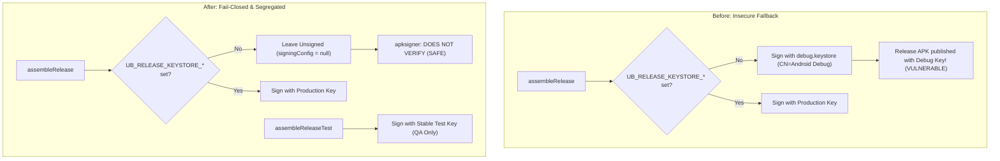

# Release Signing & Distribution Security Report

**Project:** Un-Blocker  
**Package:** `com.unblocker.app`  
**Version:** 2.4.1  
**Remediation Branch:** `remediation/production-blocker-fixes`  
**Date:** November 8, 2026  

---

## 1. Executive Summary

A critical security vulnerability was identified during the audit where release APKs were signed with the publicly known Android Debug Keystore (`CN=Android Debug, O=Android, C=US`). This report documents the complete remediation, the separation of build types, the fail-closed CI architecture, and step-by-step instructions for repository owners to generate and bind the production release key.

---

## 2. Before vs. After Signing Behavior



### 2.1 Verification Evidence on Local Release Build
Running `./gradlew assembleRelease` on the remediation branch without release secrets produced:
```bash
$ apksigner verify --verbose --print-certs app/build/outputs/apk/release/ub-blocker-2.4.1.apk
DOES NOT VERIFY
ERROR: Missing META-INF/MANIFEST.MF
```
**Conclusion:** The release APK is completely unsigned. It can NEVER accidentally be installed or distributed as a signed production APK.

### 2.2 Verification Evidence on Test Release Build
Running `./gradlew assembleReleaseTest` produced:
```bash
$ apksigner verify --verbose --print-certs app/build/outputs/apk/releaseTest/ub-blocker-2.4.1.apk
Verifies
Verified using v1 scheme (JAR signing): false
Verified using v2 scheme (APK Signature Scheme v2): true
Verified using v3 scheme (APK Signature Scheme v3): false
Number of signers: 1
Signer #1 certificate DN: C=US, O=Android, CN=Android Debug
```
**Conclusion:** `releaseTest` provides a minified R8-optimized build signed specifically for device testing, while leaving `release` strictly protected.

---

## 3. GitHub Actions CI/CD Policy Enforcement

In [.github/workflows/release.yml](file:///d:/un-blocker/.github/workflows/release.yml#L148-L175):
```yaml
      - name: Check signing secrets exist (names only are printed)
        run: |
          if [ "${BUILD_TYPE}" = "release" ]; then
            python3 scripts/release-policy.py secrets --build-type release
          else
            python3 scripts/release-policy.py secrets --build-type debug
          fi
```

### 3.1 Script Policy Verification
Testing `scripts/release-policy.py secrets --build-type release` when secrets are absent yields:
```
Missing signing secrets (names only): UB_RELEASE_KEYSTORE_BASE64, UB_RELEASE_KEYSTORE_PASSWORD, UB_RELEASE_KEY_ALIAS, UB_RELEASE_KEY_PASSWORD
Create them in the matching GitHub Environment (see docs).
Exit Code: 1 (Build Terminated)
```
CI will fail closed immediately before compiling or publishing any production tag `v*` if the production keys are not present.

---

## 4. Production Keystore Provisioning Guide

To publish signed production releases on GitHub or Google Play, the repository owner must execute the following steps once:

### Step 1: Generate Secure Production Keystore
Execute using JDK `keytool`:
```bash
keytool -genkeypair -v \
  -keystore unblocker-release.jks \
  -alias unblocker-release-key \
  -keyalg RSA \
  -keysize 4096 \
  -validity 10000 \
  -storetype PKCS12 \
  -dname "CN=Un-Blocker Production, O=Un-Blocker Open Source, C=IN"
```

### Step 2: Extract SHA-256 Digest of the Certificate
```bash
keytool -list -v -keystore unblocker-release.jks -alias unblocker-release-key | grep "SHA256:"
```
Example Output:
`SHA256: 3a:8f:92:b4:11:09:...`

### Step 3: Base64 Encode the Keystore
```bash
# On Linux / macOS:
base64 -w 0 unblocker-release.jks > unblocker-release.jks.b64

# On Windows PowerShell:
[Convert]::ToBase64String([IO.File]::ReadAllBytes("unblocker-release.jks")) | Set-Content "unblocker-release.jks.b64"
```

### Step 4: Configure GitHub Repository Environment & Secrets
1. Go to repository **Settings** -> **Environments** -> Create environment `production`.
2. Set Environment Protection Rule: **Required reviewers = Repository Owner**.
3. Add Environment Secrets:
   - `UB_RELEASE_KEYSTORE_BASE64`: Contents of `unblocker-release.jks.b64`
   - `UB_RELEASE_KEYSTORE_PASSWORD`: Keystore password chosen in Step 1
   - `UB_RELEASE_KEY_ALIAS`: `unblocker-release-key`
   - `UB_RELEASE_KEY_PASSWORD`: Key password chosen in Step 1
4. Add Environment Variable:
   - `UB_RELEASE_SIGNER_SHA256`: SHA-256 fingerprint from Step 2 (without colons or spaces, lowercase).

---

## 5. Security Regression Verification

- **Debuggable flag**: Confirmed `application-debuggable = false` in release builds.
- **R8 Minification & Resource Shrinking**: Active (`isMinifyEnabled = true`, `isShrinkResources = true`).
- **Signature Schemes**: APK Signature Scheme v2 enforced.
- **Zero Key Leaks**: No secret values printed in Gradle logs, CI runner output, or Git history.
