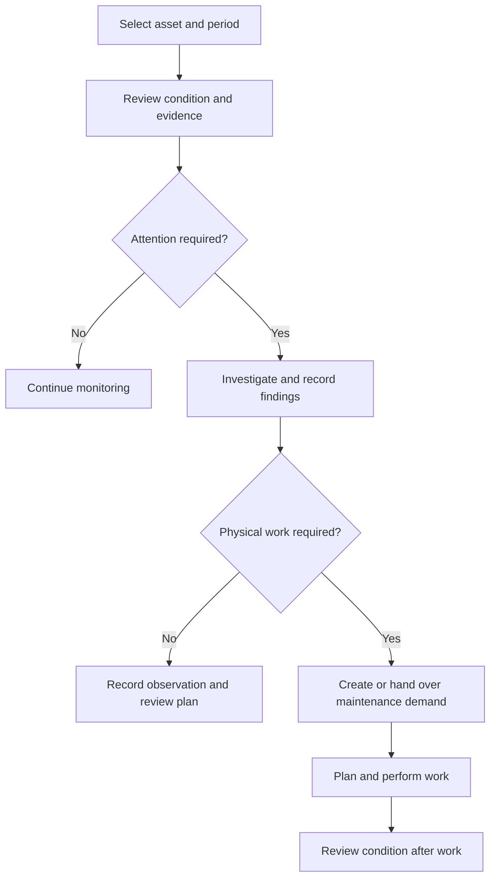
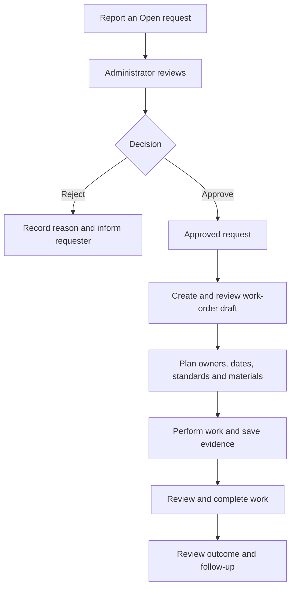

# Customer process sequences

[Documentation index](README.md) · [Complete customer manual](CMMS-APPLICATION-COMPLETE.md)

## 1. How to use this guide

This guide places the application activities in the order people normally perform them. It connects the detailed module procedures into complete operational journeys.

The **owner** in each table is a suggested business responsibility. Your organization may combine responsibilities or use different job titles. Account capabilities and user permissions still determine which application actions each person can perform.

A handoff means that the next person receives the information needed to continue. Where automation has not been confirmed for your deployment, complete and verify that handoff explicitly.

## 2. Set up the working environment

Complete the stages relevant to your operating scope before relying on the day-to-day process.

| Step | Owner | Activity | Information to prepare | Completion check |
|---|---|---|---|---|
| 1 | Account owner | Confirm the intended account experience and included modules | Organization, operating model, enabled scope | The expected working areas are agreed |
| 2 | Administrator | Create users, complete verification as required, and set active status | Names, usernames, contact details, roles | Intended users can sign in |
| 3 | Administrator | Configure permissions | Activities each person should perform | Users can reach the required actions |
| 4 | Site owner | Create the location hierarchy and assign responsible users | Location names, types, parent relationships, and at least one assigned user for each location | Sites/areas and their responsible users are established |
| 5 | Site owner / administrator | Review location access and plan equipment responsibilities | User responsibilities and the intended operating scope | Users see their relevant locations; equipment owners are ready for asset setup |
| 6 | Asset owner | Register equipment and relationships | Asset identity, type, location, parent/child context, ownership | The physical equipment is distinguishable in the application |
| 7 | Equipment engineer | Prepare diagnostic context where needed | Components, speed, bearings, electrical/nameplate information | Selected analysis has the necessary equipment meaning |
| 8 | Instrumentation owner | Register/link devices or map industrial measurements | Sensor/gateway identity, endpoints, source mappings, units | Readings belong to the intended equipment and measurement point |
| 9 | Reliability owner | Configure analysis and alarm limits | Relevant signals, severity limits, intended operating conditions | Reviewers can interpret the selected measurements and alerts |
| 10 | Administrator / asset owner | Configure alert recipients | Assigned assets and severity preferences | Intended recipients and coverage are checked |
| 11 | Materials owner | Establish parts and location stock | Part identity, unit, location, quantity, and relevant value information | Planners can inspect material availability |
| 12 | Content owner / planner | Prepare procedures, forms, templates, and contextual guidance | Standard task content, required responses, parts, and applicability | Reusable content is ready for the selected workflows |
| 13 | Planner | Prepare recurring maintenance events when required | Scope, timing, assignees, exceptions, and parts | Saved plans reflect the agreed maintenance schedule |
| 14 | Supervisor and users | Demonstrate representative working journeys | A realistic request, job, monitored asset, and report | The team can complete its agreed process |

This is a coordinated setup sequence, not a single application wizard. The [Customer onboarding checklist](04-functional-requirements-and-open-decisions.md) provides the corresponding review points.

## 3. Review condition and decide on follow-up

### 3.1 Review the equipment

1. Select the intended location and asset.
2. Confirm the asset identity and hierarchy.
3. Open the relevant health, analysis, energy, or specialist view.
4. Select the required period and review available timestamps.
5. Check units, measurement identity, missing information, and freshness.
6. Inspect meaningful changes, alarms, or observations.

**Expected result:** the reviewer understands what the available evidence says about the selected equipment and period.

### 3.2 Record the finding

1. Open the relevant alarm or observation context.
2. Review the supporting measurements or captures.
3. Record what was observed separately from the recommended action.
4. Add relevant faults, severity, or attachments where those fields are available.
5. Save and confirm the finding.
6. Identify who owns the next decision.

**Expected result:** another person can understand the finding without reconstructing the investigation.

### 3.3 Hand over maintenance demand

1. Decide whether a Work Request or a directly planned Work Order is appropriate under your process.
2. Preserve the asset, location, observation time, condition, severity, and supporting evidence.
3. Create or coordinate the appropriate maintenance record.
4. Confirm that the intended record exists and has a responsible owner.
5. After work, review the current equipment evidence and any required follow-up.

Alarm investigation does not automatically establish a maintenance order. Addressing an alarm and completing a work order are separate actions.

When using the asset-report follow-up option, verify the resulting record and its type. The option is labeled **work request**, so check the actual saved follow-up before handing it to the next person.

**Related guides:** [Health and analysis](modules/asset-health-and-analysis.md), [Energy](modules/energy-and-motor-condition.md), [Alarms and observations](modules/alarms-observations-reports-and-assistance.md).

## 4. Reactive maintenance: request to completed work

### 4.1 Report the problem

1. Open **Request** and start a new work request.
2. Enter a clear title and problem description.
3. Select the correct location and relevant asset.
4. Choose the problem type and priority.
5. Add useful supporting images where available.
6. Submit and confirm the new **Open** request.

**Handoff information:** what happened, where, which equipment is affected, when it was observed, how urgent it is, and the available evidence.

### 4.2 Review and decide

1. An eligible administrator opens the request.
2. Review the description, context, evidence, priority, and displayed target dates.
3. Approve the request if it should proceed, or reject it with an explanatory reason.
4. Confirm the resulting **Approved** or **Rejected** state.
5. For an approved request, identify the person responsible for conversion.

Approval accepts the demand for the next stage. It does not itself create an executable work order.

### 4.3 Convert and plan

1. A user with the required work-order creation permission opens an approved, unconverted request.
2. Start the work-order creation action.
3. Review the request information carried into the draft.
4. Complete the work title, scope, location/asset, owners, dates, priority, and expected effort.
5. Select the applicable procedures and planned parts.
6. Review material availability and any incomplete planning information.
7. Save the order and confirm the resulting work record and request relationship.

**Expected result:** the team has an executable job with the intended physical context and responsibility.

### 4.4 Organize and dispatch

1. Use **Planner**, **Mail View**, **Kanban View**, **Calendar View**, or **List View** for the appropriate planning task.
2. Review assignments, dates, priorities, and relevant readiness information.
3. Resolve missing planning information or material shortages.
4. Confirm with the assigned person what must be completed before starting and what will be recorded during work.
5. Start or progress the work using the permitted status actions.

Readiness is a planning aid. Required procedure submissions can also influence the displayed readiness, so distinguish pre-start preparation from answers that belong to execution.

### 4.5 Perform, record, and close

1. Confirm the work order and physical asset before beginning.
2. Review the task, attached procedures, planned parts, and contextual instructions.
3. Perform the work and record the actual contribution, applicable dates/hours, and material information.
4. Answer the required procedure questions and save the responses.
5. Add relevant photographs, notes, and other evidence through the available capture or editing actions.
6. Record a blocker or on-hold context when work cannot continue.
7. Open the detailed work record and check that required answers and execution information are saved.
8. Resolve missing capture information through the available editing/capture actions.
9. Move the order to completion using the permitted action.
10. Reopen or review the saved result and identify any remaining follow-up.

**Expected result:** the order's status is supported by readable evidence of the work performed.

Status changes in different views do not provide identical prompts. Use an agreed closeout review even when a view offers a quick status change. The [Work Orders guide](modules/work-orders.md) explains which capture and completion actions belong to each view.

### 4.6 Manage common exceptions

| Situation | What to inspect | Next action |
|---|---|---|
| Rejected request | Rejection reason and original evidence | Clarify the issue with the reviewer; submit a new request if that is the agreed next step |
| Approved request without an order | Conversion link and responsible person | Coordinate the work-order creation step |
| Missing assignment or dates | Planner and detailed work information | Complete the plan before dispatch |
| Material shortage | Part identity and stock at the required location | Coordinate a transfer, stock correction, or supply action through the agreed materials process |
| Blocked or on-hold work | Status, reason, and outstanding dependency | Assign an owner to resolve the blocker |
| Parent and child work | Execution ownership and related records | Record work on the designated execution record |
| Uncertain save result | Connection message and current record contents | Reconnect, reopen, and verify before retrying |

## 5. Use reusable standards to plan work

### 5.1 Prepare the standard

1. Establish any required part records and location stock.
2. Create a Procedure with clear questions, answer choices, required responses, and relevant conditions.
3. Add standard required parts where appropriate.
4. Create a Work Order Template with common scope, priority, owners, procedures, parts, and timing settings.
5. Review the template preview for its intended use.

### 5.2 Use the standard on a real job

1. Select the appropriate template and choose **Use Template**.
2. Review the resulting work-order draft.
3. Confirm the actual location, asset, owners, dates, procedures, and materials.
4. Complete the remaining required information and save.
5. During execution, answer and save the attached procedure responses.
6. Review any scores or corrective-action prompts and assign follow-up where needed.

**Expected result:** reusable content provides a starting point for a reviewed, job-specific work order.

Use Template applies a subset of stored settings and selects the first stored location and asset. Review the draft rather than assuming that every field control or recurrence setting governs the order. A corrective-action prompt does not itself confirm that a separate corrective order has been created.

**Related guides:** [Procedures](modules/procedures.md), [Template Library](modules/template-library.md), [Work Orders](modules/work-orders.md).

## 6. Prepare preventive maintenance

1. Open **Preventive** and create a maintenance event.
2. Enter the task title and useful scope information.
3. Choose the intended location and asset where applicable.
4. Select responsible users and expected effort.
5. Define Daily, Weekly, or Monthly timing and the relevant interval/days.
6. Review the start date, end or repeat policy, and any skipped dates or weekends.
7. Add planned parts where needed.
8. Save and confirm the event's **Active/In-Active** state.
9. Confirm with your implementation contact when and how future work is produced for your deployment.
10. Review the first representative resulting work item and its dates, scope, owners, and materials.
11. Follow the normal work-order process for any generated order.
12. Review subsequent occurrences and exceptions as part of maintenance planning.

**Expected result:** the saved plan matches the intended maintenance obligation, and the team has confirmed its operational scheduling behavior.

A saved preventive event and a generated work order are different records. Changing the plan's active state does not by itself explain the state of existing orders. The preventive register's **Overdue** display is not a complete measure of preventive-work compliance.

**Related guide:** [Preventive maintenance](modules/preventive-maintenance.md).

## 7. Manage materials through the work cycle

1. Create or import the part with a clear identity and unit.
2. Establish accurate stock at the relevant location.
3. Review availability when planning work.
4. Add the intended quantities to the work order or preventive plan.
5. Transfer or adjust stock where permitted and appropriate.
6. Record actual usage in the available execution fields.
7. Review the resulting part balance and movement history.
8. Resolve differences through the agreed inventory process.

**Expected result:** planning and execution refer to the same material identity and location.

Planned quantity, recorded availability, and actual consumption have different meanings. Confirm the stock effects of your chosen work process during onboarding; do not assume that planning a part reserves or issues it.

**Related guides:** [Parts and inventory](modules/parts-inventory.md), [Work Orders](modules/work-orders.md).

## 8. Prepare forms and review inspections

### 8.1 Prepare form content

1. Create a form category if needed.
2. Create a named form and select its category and location.
3. Add the intended question content.
4. Save and preview the form.
5. Confirm where that form will be used in the organization's agreed capture process.

### 8.2 Review inspection records

1. Open the approved **Inspections** entry.
2. Review the **To Do** list.
3. Select a record and inspect its title, form, location/asset, assigned users, start date, and status.
4. Review the recorded-answer count as a summary of available responses.
5. Use **Done** to review records marked Completed.

**Expected result:** form content is prepared and existing inspection records can be reviewed.

The Inspections screen described here is a review worklist. It does not provide answer entry, assignment, or completion controls. A full inspection capture process must be separately established for your deployment.

**Related guides:** [Forms](modules/forms.md), [Inspections](modules/inspections.md).

## 9. Review performance and communicate

1. Select the relevant location/asset and period.
2. Use **KPI** to identify condition or maintenance items requiring attention.
3. Open the relevant detail or report to understand the underlying information.
4. Check timestamps, units, scope, and any unavailable values.
5. Select or request the appropriate monitoring, health, sensor, asset, location, or enabled specialist report.
6. Review the available result before downloading or using it in a decision.
7. Assign maintenance follow-up where required.
8. Publish appropriate operational communications through **Post** or maintain applicable contextual guidance.
9. Consult **Help & Guides** for published reference material.
10. Follow notifications to the relevant records and act on the underlying work.

**Expected result:** reports and communications lead to understandable, owned actions.

Publishing content, reading a notification, and closing a work order are separate activities. Use the record appropriate to the actual outcome.

**Related guides:** [Dashboards](modules/dashboards.md), [Reports](modules/reports.md), [Posts](modules/posts.md), [Knowledge Base](modules/knowledge-base.md), [Notifications](modules/notifications.md).

## 10. Information that should survive each handoff

| Handoff | Preserve this information |
|---|---|
| Equipment setup → monitoring | Asset/component identity, measurement point, units, timestamps, and relevant equipment details |
| Monitoring → maintenance demand | Location, asset, finding, observation time, severity, evidence, and recommended action |
| Request → work order | Problem context, review decision, priority, physical scope, and request relationship |
| Planning → technician | Scope, owners, dates, procedures, materials, preparation, and expected evidence |
| Technician → supervisor | Actual work, saved answers, labor/material information, exceptions, and follow-up |
| Work → reporting | Consistent status, dates, scope, units, and completed record information |
| Content owner → user | Applicability, readable steps/questions, and a responsible contact for corrections |

Use [Information requirements and impact](03-information-requirements-and-impact.md) to prepare these information packages before rollout.
